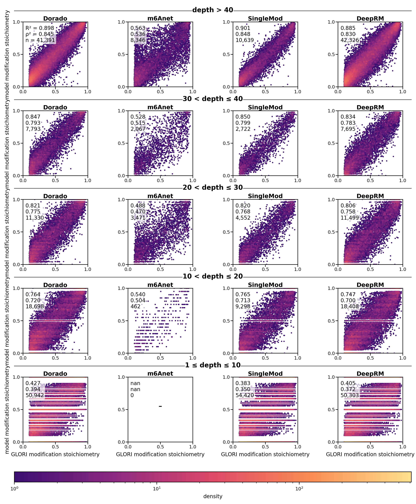

# RNA004-m6A-benchmark

Workflow scripts, metadata, environment definitions, benchmarking utilities, and
selected benchmark figures for RNA004 nanopore direct RNA sequencing m6A
detection. The project compares four detection routes:

- Dorado
- DeepRM
- m6Anet
- SingleMod

Supported cell-line benchmarks:

- HEK293/HEK293T RNA004 direct RNA data, primarily compared with GLORI.
- HeLa RNA004 direct RNA data, primarily compared with eTAM-seq.

Do not label GLORI as the HeLa ground truth, and do not label eTAM-seq as the
HEK293T ground truth.

## Selected Benchmark Results

The figures below are representative final benchmark outputs, not the complete
set of generated files. PNG files are embedded for quick viewing; matching PDF
files are linked for full-resolution inspection. See `results/README.md` for the
public result files currently documented in this repository.

### PRJEB80229 HeLa RNA004 Benchmark

Representative site-level stoichiometry comparison for the PRJEB80229 HeLa
RNA004 dataset. Predictions from Dorado, m6Anet, SingleMod, and DeepRM are
compared with eTAM-seq sites across read-depth strata.

<p align="center">
  
</p>

Full-resolution figure:
[PRJEB80229_HeLa_total_benchmark.pdf](results/PRJEB80229_HeLa_total_benchmark.pdf)

### PRJEB80229 HEK293T RNA004 Benchmark

Representative site-level stoichiometry comparison for the PRJEB80229 HEK293T
RNA004 dataset. Predictions from Dorado, m6Anet, SingleMod, and DeepRM are
compared with GLORI ground truth across read-depth strata.

<p align="center">
  
</p>

Full-resolution figure:
[PRJEB80229_HEK293T_total_benchmark.pdf](results/PRJEB80229_HEK293T_total_benchmark.pdf)

## Data Flow by Tool

### Dorado

Citation: Oxford Nanopore Technologies. Dorado: Oxford Nanopore's basecaller.
GitHub/software documentation. https://github.com/nanoporetech/dorado

Citation: Oxford Nanopore Technologies. Modkit: a bioinformatics tool for
working with modified bases from Oxford Nanopore, including conversion of
modBAM to bedMethyl. GitHub/software documentation.
https://github.com/nanoporetech/modkit

```text
POD5
  -> Dorado basecaller with m6A modified-base calling and alignment
sorted modBAM with MM/ML tags
  -> samtools index
BAM + BAI
  -> modkit pileup
site-level bedMethyl
  -> scripts/01_dorado/dorado_03_make_sitelevel_table.sh
Dorado site-level TSV
  -> scripts/03_standardization/01_standardize_site_tables.py dorado
standardized genomic site-level TSV
  -> optional duplicate-site collapse
  -> GLORI comparison for HEK293T or eTAM-seq comparison for HeLa
```

Dorado read-level modified-base information is stored in MM/ML tags. Modkit is
used for site-level aggregation. Each run must document whether the reference
used for alignment was a transcript FASTA or a GRCh38 genome FASTA.

### DeepRM

The DeepRM citation is still incomplete in this repository. See
`docs/citations.md` for the specific `TO VERIFY` items.

```text
POD5 + compatible aligned BAM
  -> scripts/01_deeprm/deeprm_01_call_prep.sh
prepared DeepRM input
  -> scripts/01_deeprm/deeprm_02_call_run.sh
DeepRM output
  -> scripts/01_deeprm/deeprm_03_make_sitelevel_table.sh
DeepRM transcript-level site table
  -> scripts/03_standardization/01_standardize_site_tables.py deeprm
standardized transcript-level site table
  -> scripts/03_standardization/02_convert_transcript_to_genome.py
GRCh38 genomic site-level table
  -> optional duplicate-site collapse
  -> GLORI comparison for HEK293T or eTAM-seq comparison for HeLa
```

The DeepRM model path is provided to the shell wrappers with
`DEEPRM_MODEL_FILE`. Do not commit personal installation paths.

### m6Anet

Citation: Hendra, C. et al. Detection of m6A from direct RNA sequencing using a
multiple instance learning framework. Nature Methods 19, 1590-1598 (2022).
https://doi.org/10.1038/s41592-022-01666-1

```text
POD5
  -> Dorado basecalling/alignment -> sorted BAM -> samtools fastq -> FASTQ
  -> blue-crab p2s -> BLOW5 -> f5c index

sorted BAM + FASTQ + BLOW5 + transcript FASTA + RNA004 5-mer model
  -> f5c eventalign
eventalign.tsv
  -> m6anet dataprep
prepared input
  -> m6anet inference with --pretrained_model HEK293T_RNA004
chunk-level data.site_proba.csv files
  -> scripts/01_m6anet/m6anet_06_merge_site_proba.sh
merged m6Anet transcript-level table
  -> scripts/03_standardization/01_standardize_site_tables.py m6anet
standardized transcript-level site table
  -> scripts/03_standardization/02_convert_transcript_to_genome.py
GRCh38 genomic site-level TSV
  -> optional duplicate-site collapse
  -> GLORI comparison for HEK293T or eTAM-seq comparison for HeLa
```

This project uses the BLOW5/f5c RNA004 signal route, not a FAST5-based m6Anet
workflow. For HEK293T, `HEK293T_RNA004` is documented as the matched RNA004
pretrained model. For HeLa, the same model may be run only as a cross-cell-line
generalization experiment; it is not a HeLa-specific m6Anet model.

### SingleMod

Citation: Xie, Y.-Y. et al. Single-molecule direct RNA sequencing reveals the
shaping of epitranscriptome across multiple species. Nature Communications 16,
5119 (2025). https://doi.org/10.1038/s41467-025-60447-4

```text
POD5
  -> scripts/01_singlemod/singlemod_01_prepare_fastq_blow5.sh
FASTQ + BLOW5
  -> scripts/01_singlemod/singlemod_02a_make_transcript_chunks.sh
  -> scripts/01_singlemod/singlemod_02b_run_chromosome_array.sh
chromosome-level SingleMod outputs
  -> scripts/01_singlemod/singlemod_03_collect_sitelevel.sh
genomic site-level TSV
  -> optional duplicate-site collapse
  -> GLORI comparison for HEK293T or eTAM-seq comparison for HeLa
```

SingleMod output is already genomic when it uses chromosome-level genome-aligned
BAM and GRCh38 FASTA. Do not add a GTF transcript-to-genome conversion step for
that route. Site-level stoichiometry is calculated as `m6A_count / Total`.

## Reference and Coordinate Conventions

Citation: GENCODE Consortium. GENCODE Human Release 49 (GRCh38.p14;
corresponding to Ensembl 115). https://www.gencodegenes.org/human/release_49.html

See `docs/references_and_coordinates.md`. In short:

- GENCODE v49 transcript FASTA headers should be cleaned to retain transcript
  IDs.
- Transcript FASTA names should match GTF `transcript_id`.
- BED start is 0-based.
- GTF genomic coordinates are 1-based inclusive.
- m6Anet `transcript_position` is treated as 0-based by the current
  standardization workflow.
- Site tables should use explicit names such as `start_0based`, `pos_1based`,
  and `transcript_position_0based`.

## Script Execution Order

### HEK293T + GLORI

Citation: the current HEK293T ground truth is derived from GLORI samples
GSM6432590 and GSM6432591 in GSE210563; cite the GLORI method paper and GEO
records listed in `docs/citations.md`.

1. Set the local environment variables required by the selected shell wrappers.
2. Run Dorado basecalling/alignment or provide compatible existing BAM/FASTQ
   inputs.
3. Run each selected tool: Dorado, DeepRM, m6Anet, and/or SingleMod.
4. Standardize tool outputs with `scripts/03_standardization/`.
5. Convert transcript-level outputs to GRCh38 genomic coordinates where needed.
6. Compare genomic predictions to GLORI with `scripts/04_benchmarking/`.
7. Run depth-stratified correlation and visualization steps.

### HeLa + eTAM-seq

1. Set the local environment variables required by the selected shell wrappers.
2. Run Dorado basecalling/alignment or provide compatible existing BAM/FASTQ
   inputs.
3. Run selected tools. For m6Anet, document use of `HEK293T_RNA004` as a
   cross-cell-line generalization experiment.
4. Standardize tool outputs with `scripts/03_standardization/`.
5. Convert transcript-level outputs to GRCh38 genomic coordinates where needed.
6. Compare genomic predictions to eTAM-seq with `scripts/04_benchmarking/`.
7. Run depth-stratified correlation and visualization steps.

## Software and Environments

Expected tools include Dorado, SAMtools, Modkit, f5c, blue-crab, DeepRM,
m6Anet, SingleMod, bedtools, Python, and shell utilities. Environment
definitions are stored under `envs/`. Verified versions and unresolved citation
status are recorded in `metadata/software_versions.tsv`; do not invent versions
or citations.

## Data Policy

Large data files and generated intermediate outputs must not be committed to
Git. Selected final benchmark figures are allowlisted in `.gitignore`; all other
large or temporary files under `results/` remain ignored by default.
