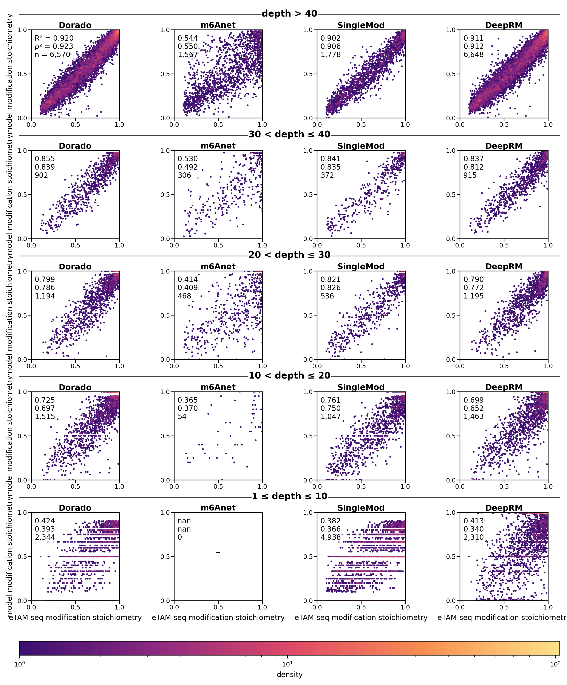

# RNA004-m6A-benchmark

This repository benchmarks RNA004 nanopore direct RNA m6A calls from Dorado,
DeepRM, m6Anet, and SingleMod against cell-line-specific orthogonal datasets:
GLORI for HEK293/HEK293T and eTAM-seq for HeLa.

## Workflow

The executable routes are documented in `docs/` and implemented under
`scripts/`:

1. Tool-specific calling and site aggregation: `scripts/01_*`.
2. GLORI and eTAM-seq preparation: `scripts/02_ground_truth/`.
3. Site-table standardization and transcript-to-genome conversion:
   `scripts/03_standardization/`.
4. Site matching, correlation analysis, and depth stratification:
   `scripts/04_benchmarking/`.
5. Final figure generation: `scripts/05_visualization/`.

DeepRM and m6Anet produce transcript-coordinate site tables in the documented
routes. They are standardized first and then converted with
`scripts/03_standardization/02_convert_transcript_to_genome.py`. SingleMod is
already genomic in its chromosome-based route. Dorado uses the coordinate
system of the reference supplied during basecalling.

Tool-specific commands and inputs are described in
[`docs/dorado.md`](docs/dorado.md), [`docs/deeprm.md`](docs/deeprm.md),
[`docs/m6anet.md`](docs/m6anet.md), and
[`docs/singlemod.md`](docs/singlemod.md).

## Datasets and Ground Truth

| Cell line | RNA004 benchmark datasets shown here | Ground truth |
|---|---|---|
| HeLa | PRJEB80229 | eTAM-seq, derived locally from GSE211303 HeLa poly(A) WT FTO-/FTO+ replicates |
| HEK293T | PRJEB80229; PRJEB106788 | GLORI, GSE210563 GSM6432590 and GSM6432591 |

The curated genomic tables are
`metadata/ground_truth_datasets/HeLa_eTAM_FTOm_FTOp_rep1_rep2_rep3_intersection_mean.tsv`
and
`metadata/ground_truth_datasets/HEK293T_GLORI_rep1_rep2_intersection_mean.tsv`.
See [`docs/ground_truths.md`](docs/ground_truths.md) for provenance.

## Selected Benchmark Results

### PRJEB80229 HeLa

Dorado, m6Anet, SingleMod, and DeepRM site-level stoichiometry compared with
eTAM-seq across read-depth strata.

  

[PDF](results/PRJEB80229_HeLa_total_benchmark.pdf)

### PRJEB80229 HEK293T

The same four-tool comparison against GLORI across read-depth strata.

  

[PDF](results/PRJEB80229_HEK293T_total_benchmark.pdf)

Additional public final figures are listed in
[`results/README.md`](results/README.md).

## Environments

Conda definitions are under `envs/`, including `dorado_env.yml`,
`deeprm_env.yml`, `m6anet_env.yml`, `singlemod_env.yml`, and
`benchmarking_env.yml`. Verified software and model identifiers are recorded in
[`metadata/software_versions.tsv`](metadata/software_versions.tsv). Shell
wrappers take local paths and run settings from environment variables.

## Citations

DeepRM is cited as Kang et al., *Nature Communications* 17, 664 (2026), DOI
[`10.1038/s41467-025-67417-w`](https://doi.org/10.1038/s41467-025-67417-w).
The HeLa orthogonal dataset is from Xiao et al., *Nature Biotechnology* 41,
993-1003 (2023), DOI
[`10.1038/s41587-022-01587-6`](https://doi.org/10.1038/s41587-022-01587-6).
Dorado is cited using its
[official repository and documentation](https://github.com/nanoporetech/dorado).
Full software, method, reference, and dataset citations are in
[`docs/citations.md`](docs/citations.md).
